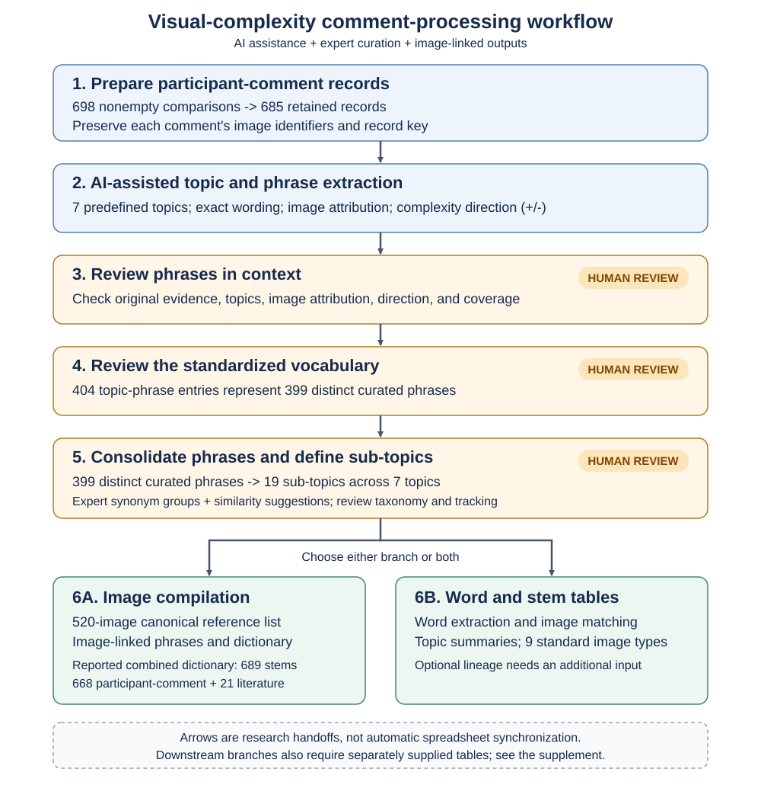

# VC Comment Processing

Turns raw visual-complexity (VC) user comments into curated phrases, sub-topics,
and a final keyword/stem dictionary. Conceptually, the workflow has three
phases: LLM-assisted classification into seven topics and phrase extraction; expert curation,
consolidation, reduction, and subtopic construction; and image-level mapping
with dictionary and optional reporting outputs. The notebooks expose the operational steps and
spreadsheet checkpoints for these phases.

For a standalone, researcher-facing account, see
[From Participant Comments to a Visual-Complexity Vocabulary](RESEARCH_WORKFLOW.md).
The overview uses the same spreadsheet names, checkpoints, and reported counts
as this execution guide.



## Workbook, tab, and GID convention

Each Google Sheets workbook has a **spreadsheet ID**. Each tab inside that
workbook has a **gid** (the numeric tab identifier). A gid is only meaningful
together with its spreadsheet ID; the same number in another workbook is a
different tab. In the notebooks, variables named `sheet_id` or
`sheet_*_id` contain a gid, not a workbook ID.

For clarity, this README writes `gid` before every tab number. The equivalent
loader call is:

```python
df = load_sheet(spreadsheet_id, gid)
```

The repository uses these workbook contexts. Titles and tab names were checked
against the live spreadsheets on November 23, 2026.

| Spreadsheet name and role | Spreadsheet ID | Tabs used |
| --- | --- | --- |
| PostquestionareAnalysisGPT5: source comments, earlier mappings, summaries, and image order | `1gfeYdT-RxLq9tvNpfv_P8AIKg2eSz6-8bSv5zUJsWEc` | `0.postquestionare_all` (gid `1103808983`); `1.keyword.S&Y(AI+humanCuration)` (gid `1166121277`); `Expired.1.keyword.Z&AA(AI+humanCuration)` (gid `1841871821`); `5.imageTypeTopics` (gid `1390591889`); `2.keyword.CountByVisTypes` (gid `1160817631`); `5.1 imagePhraseCompile` (gid `1429789806`) |
| ResultsStepByStep: current reduction and per-image inputs | `1cVCOfBjHmcvsyrn7U0CbXoBSksF4JDRqWYm-ZJPbL4k` | `2.curatedPhrases` (gid `517808299`); `1.phraseCuration` (gid `1455332435`); `0.postquestionare_all` (gid `1540814304`); `4.0.imageDataCompiled` (gid `483858074`) |
| VisComplexity.PerceivedScoreAndObjectiveMetrics: image metadata used by notebook 1 | `1eJ3VUh2ZKZy6S6qo9nzF8h0rwwMNBhwuK42wdgeS54w` | `FormalExp1800Images` (gid `1073958835`), including image visualization types |
| Sub.Vis2025VisComplexity.PerceivedScoreAndObjectiveMetrics: VC score reference | `1N6nK03QiPAM6AELb9kC3beETnKmG6u23` | `FormalExp1800Images` (gid `67202923`), including normalized VC values |

The first two spreadsheets each have a `0.postquestionare_all` tab, but these
are separate inputs and are not automatically synchronized. Likewise, the
earlier mapping tab in PostquestionareAnalysisGPT5 is not the
`1.phraseCuration` tab in ResultsStepByStep. Record both workbook and tab for
every handoff; prefer the variable name `gid` in new code.

Historical references to `1.phraseCuration` at gid `1166121277`,
`6.imageTypeTopics` at gid `1390591889`, and `A.keyword.CountByVisTypes` at gid
`1160817631` refer to the current PostquestionareAnalysisGPT5 names above.

## Pipeline at a glance

Run the core path in order, pausing for the spreadsheet curation checkpoints.
After phrase reduction, choose the downstream branch or run both. Notebooks
write CSV outputs under `data_processing/`; they do not automatically upload
those files back to Google Sheets.

```text
CORE PATH

0. Source study data
   Read:  PostquestionareAnalysisGPT5 / 0.postquestionare_all (gid `1103808983`)
   Apply ToRemove: 698 nonempty records -> 685 retained records.
   Local: data_table/paired_comparison.csv
      |
      v
1. LLM extraction: notebook 1
   Write local extraction files, then paste the generated extraction columns
   back into 0.postquestionare_all, preserving the `index` row key.
      |
      v
2. HUMAN CURATION CHECKPOINT
   Edit in PostquestionareAnalysisGPT5 / 0.postquestionare_all (gid `1103808983`):
     CuratePhrasesMoreComplex
     CuratePhrasesLessComplex
   Review topic assignments, phrase wording, image attribution, and (+)/(-)
   complexity direction (not positive/negative emotion).
      |
      v
3. Phrase mapping: notebook 2
   Read:  PostquestionareAnalysisGPT5 / 0.postquestionare_all (gid `1103808983`)
      and 1.keyword.S&Y(AI+humanCuration) (gid `1166121277`) for existing mappings.
   Write: data_processing/term_mapping_regenerated.csv
      data_processing/phrase_pivot_regenerated.csv
   Review and refresh 1.keyword.S&Y(AI+humanCuration), especially `AIcurated`
   and `HumanCuration`, then refresh ResultsStepByStep / 2.curatedPhrases
   (gid `517808299`).
      |
      v
4. Phrase reduction: notebook 3
   Read:  ResultsStepByStep / 2.curatedPhrases (gid `517808299`).
   Per-image section also reads that workbook's 1.phraseCuration
      (gid `1455332435`), 0.postquestionare_all (gid `1540814304`), and
      4.0.imageDataCompiled (gid `483858074`); refresh these inputs as needed.
   Review the manual synonym groups, shortlist, and sub-topic taxonomy.
   Write: phrase_shortlist.csv, subtopic_taxonomy.csv,
      phrase_reduction_tracking.csv, image_phrase_word_mapping.csv

DOWNSTREAM BRANCH A: IMAGE COMPILATION

5A. notebook 4
    Requires the notebook 3 outputs plus external
    data_processing/image_compiled_phrases.csv,
    data_processing/term_mapping.csv, and a prior
    data_processing/stem_dictionary.csv. See "External artifacts" below.
    Write: image_compiled_phrases.csv, stem_dictionary.csv, and reports.

DOWNSTREAM BRANCH B: WORD AND STEM TABLES

5B. notebook 5
    Requires data_processing/term_mapping.csv. Its later cells also read
    PostquestionareAnalysisGPT5 / 0.postquestionare_all (gid `1103808983`)
    and 1.keyword.S&Y(AI+humanCuration) (gid `1166121277`) for image matching.
    Write: unique_words.csv, image_phrase_matching.csv, unique_words_by_*.csv
      |
      v
6B. notebook 6
    Read:  image_phrase_matching.csv and, for the lineage section,
       phrase_lineage_all_vistypes.csv.
    Write: unique_stems*.csv.

OPTIONAL WORKBOOK HANDOFF

In PostquestionareAnalysisGPT5, refresh 5.imageTypeTopics (gid `1390591889`)
from compiled per-image results, then 2.keyword.CountByVisTypes
(gid `1160817631`) when needed.
```

## Human curation checkpoints

Human curation happens after the first notebook has produced or refreshed the AI
extraction fields and before phrase reduction:

1. In PostquestionareAnalysisGPT5 / `0.postquestionare_all` (gid `1103808983`), review the extracted phrases for
   each more-complex and less-complex image. Store the reviewed topic-to-phrase
   JSON in `CuratePhrasesMoreComplex` and `CuratePhrasesLessComplex`.
2. Run `2_phrase_curation.ipynb`. It collects all reviewed phrases from the
   source tab and preserves existing mappings from that workbook's
   `1.keyword.S&Y(AI+humanCuration)`.
3. Review the generated `HumanCuration` labels in `1.keyword.S&Y(AI+humanCuration)`
   (gid `1166121277`). This is the mapping from each original phrase to the final
   human-curated phrase used downstream.
4. Refresh ResultsStepByStep / `2.curatedPhrases` (gid `517808299`) with the
   curated phrase table before running `3_phrase_reduction.ipynb`. For its
   per-image section, also refresh ResultsStepByStep / `1.phraseCuration`
   (gid `1455332435`) with the intended reviewed mappings.
5. During notebook 3, review manual synonym groups, the phrase shortlist, and
   the sub-topic taxonomy. Do not treat the TF-IDF suggestions as a substitute
   for expert review.

### What to extract and where to put it

| Stage | Extract/read from | Manually write or paste back | Local artifact |
| --- | --- | --- | --- |
| Raw study data | PostquestionareAnalysisGPT5 / `0.postquestionare_all`, gid `1103808983` | None before notebook 1 | `data_table/paired_comparison.csv` |
| AI phrase extraction | Source rows and comment columns in that source tab | AI extraction columns in the same tab, aligned by `index` | `data_processing/extracted_*.csv`, `CuratedPhrasesCombined.csv` |
| Human phrase review | `CuratePhrasesMoreComplex` and `CuratePhrasesLessComplex` in that source tab | Reviewed JSON phrase assignments in those same columns | `data_processing/term_mapping_regenerated.csv` |
| Phrase mapping review | PostquestionareAnalysisGPT5 / `1.keyword.S&Y(AI+humanCuration)`, gid `1166121277` | `AIcurated` and `HumanCuration` values | `data_table/phrase_curation.csv` for the shipped local copy |
| Reduction input | ResultsStepByStep / `2.curatedPhrases`, gid `517808299` | Refresh the curated phrase/count table | `data_table/curated_phrases.csv` for the shipped local copy |
| Per-image mapping input | ResultsStepByStep / `1.phraseCuration`, gid `1455332435` | Refresh the intended reviewed mapping | Live workbook input; no registered local snapshot |
| Per-image workbook refresh | Compiled outputs from notebooks 3-4 | Optional refresh of PostquestionareAnalysisGPT5 / `5.imageTypeTopics`, gid `1390591889` | `image_compiled_phrases.csv` and summaries |

## External artifacts

The repository intentionally does not include every historical intermediate CSV.
Before running the downstream branches, confirm that these files exist under
`data_processing/`:

| File | Consumed by | Required columns or role |
| --- | --- | --- |
| `term_mapping.csv` | notebooks 4 and 5 | Notebook 5 reads `Original`, `AIcurated`, `HumanCurated`; notebook 4 core reads lowercase `original` and `OriginalSign`. A shared export must include both `original` and `Original` with identical phrase values. Optional notebook 4 sentiment reports also use `HumanCurated` and `HumanCuratedSign`. |
| `image_compiled_phrases.csv` | notebook 4 | Existing per-image phrase table used as the compilation source |
| `stem_dictionary.csv` | notebook 4 setup and later dictionary cells | Existing or previously generated original-stem dictionary |
| `phrase_lineage_all_vistypes.csv` | notebook 6 lineage section | Mapping from `original_phrase` to `final_subtopic_phrase` |

Notebook 2 creates `term_mapping_regenerated.csv`, a wide per-topic table. It
does not create the long-format `term_mapping.csv` expected by notebooks 4 and
5. Adapt or export the regenerated table into that schema before using those
notebooks. Likewise, `phrase_lineage_all_vistypes.csv` is not produced by the
current notebook 3 cells and must be supplied if the notebook 6 lineage report
is needed.

Column names are case-sensitive. The reviewed workbook field is
`HumanCuration`, while the downstream long-format file uses `HumanCurated`;
adapt these names explicitly at export. The notebooks do not currently
normalize the two original-phrase column spellings automatically.

When using local mode, update the corresponding CSV under `data_table/` after
making a spreadsheet change. `data_processing/` is ignored by Git because its
contents are regenerated by the notebooks.

## Key numbers

| Quantity | Value |
| --- | --- |
| Comparison pairs (comments) | 698 nonempty rows (685 kept after `ToRemove`) |
| Canonical image reference list | 520 |
| VC topics / standard VisType categories | 7 / 9 |
| Curated topic-phrase entries | 404 |
| Distinct curated phrases entering reduction | 399 |
| Sub-topics after reduction | 19 (3/3/3/3/2/2/3 per topic) |
| Dictionary stems | 689 (668 user-comment + 21 literature) |

The 7 topics are Data Density / Image Clutter (DDIC), Visual Encoding Clarity
(VEC), Semantics / Text Legibility (STL), Schema (SCH), Color, Symbol, and
Texture Details (CSTD), Aesthetics Uncertainty (AU), and Immediacy / Cognitive
Load (ICL).

These figures are reported workflow totals, not results of a fresh run.
Comparison records are not participant counts. The 520-image canonical list
is a downstream subset, not the full set of source images. The curated table
has 404 topic-phrase entries and 399 distinct phrase strings because five
phrases each belong to two topics. The nine standard VisTypes are reporting
categories; source records also contain other and mixed-type labels. The 689-stem total
includes literature contributions and is not a guaranteed notebook output
size on every rerun.

## Reading the data: two ways

The paired-comparison study table and other supported tabs can be read from the
master Google Sheet or from local CSV copies:

```python
import config
from data_loader import load_paired_comparison, load_sheet

# Live Google Sheet
pairs = load_paired_comparison(source="master")

# Local copy under data_table/
pairs = load_paired_comparison(source="local")

# Any tab by spreadsheet ID and gid. Only the three tabs listed in
# config.LOCAL_SHEET_MAP are available locally; other gids fall back online.
df = load_sheet(config.MASTER_SHEET_ID, "517808299", source="local")
```

The default source is `config.DATA_SOURCE` (`"master"`). Set
`VC_DATA_SOURCE=local` to use the shipped CSV snapshots where available; an
unmapped or missing local tab prints a message and falls back to the live
Google Sheet. Sheet IDs, tab mappings, topic names, VisTypes, and folder
locations are defined in `config.py`.

Here `"master"` means live Google Sheets, not that every table comes from
ResultsStepByStep. `load_paired_comparison()` reads PostquestionareAnalysisGPT5.
Local lookup is currently keyed by gid only, so a registered local snapshot
does not verify its workbook ID; use the documented workbook/gid pairs.

## Notebook summary

| # | Notebook | Purpose | Main outputs |
| --- | --- | --- | --- |
| 1 | `1_llm_extraction.ipynb` | Classify topics, extract phrases/effects, split sentiment, and aggregate keywords by image | `keyword_counts_by_vistype.csv`, `image_all_keywords_expanded.csv` |
| 2 | `2_phrase_curation.ipynb` | Rebuild the phrase mapping from all reviewed source-tab phrases | `term_mapping_regenerated.csv`, `phrase_pivot_regenerated.csv` |
| 3 | `3_phrase_reduction.ipynb` | Reduce the reviewed vocabulary into named sub-topics | `phrase_shortlist.csv`, `subtopic_taxonomy.csv`, `phrase_reduction_tracking.csv` |
| 4 | `4_image_compilation.ipynb` | Downstream branch A: compile per-image phrases, sentiments, stems, sub-topics, and reporting tables | `image_compiled_phrases.csv`, `stem_dictionary.csv` |
| 5 | `5_keyword_extraction.ipynb` | Downstream branch B: create lemmatized word tables and image phrase matching | `unique_words*.csv`, `image_phrase_matching.csv` |
| 6 | `6_keyword_stems.ipynb` | Continue branch B with Snowball stem tables; the optional final-phrase lineage section needs an additional lineage CSV | `unique_stems*.csv` |

## Layout

```text
config.py            shared config: sheet IDs, topics, VisTypes, paths, data source
data_loader.py       load_sheet() / load_paired_comparison()
requirements.txt
data_table/          local CSV copies of key Google Sheet tabs
data_processing/     notebook outputs (Git-ignored)
notebooks/           1..6 pipeline notebooks
RESEARCH_WORKFLOW.md  standalone researcher-facing method and supplement
docs/                shared SVG pipeline diagram
```

## Setup

```bash
pip install -r requirements.txt
python -m spacy download en_core_web_sm
```

Run notebooks from the repository root, or use the portable setup cell included
in each notebook. Notebook 1 calls the OpenAI API; set `OPENAI_API_KEY` in your
environment before running the LLM cells. The spaCy model is required by
notebooks 4-6. Internet access is required for live Google Sheet reads and
OpenAI calls.

## Notes

- Notebook 3 uses manual synonym groups plus per-topic TF-IDF and universality
  scoring. The final named sub-topics require expert review.
- Keep the `index` column as the row key when copying notebook results back into
  the source study tab.
- Notebook 1 contains legacy keyword-curation and image-analysis sections; use
   the execution guide in the notebook to select the relevant branch.
- Notebook 4 contains optional pivots, sentiment reports, top-k reports, and
   literature-factor analysis after its core compilation cells.
- The local CSV files are snapshots, not automatic two-way synchronizations with
  Google Sheets.
