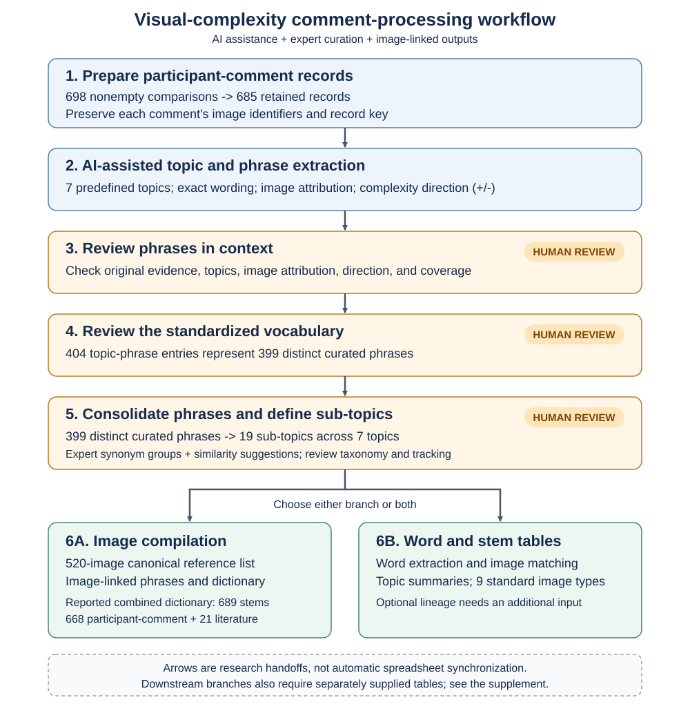

# From Participant Comments to a Visual-Complexity Vocabulary

## Background

Participants describe visual complexity in concrete terms: overlapping marks, hard-to-read labels, unfamiliar forms, or the time needed to understand an image. These comments help explain what a complexity judgment means to the person making it.

The analysis organizes those explanations into a vocabulary of perceived visual complexity (VC). A large language model (LLM) identifies relevant passages and proposes assignments to seven predefined topics. Researchers check the passages against the comments, bring similar expressions together, and group them into sub-topics. The resulting vocabulary remains linked to the original comments and images.

The code and selected data tables are available in [VC Comment Processing](https://github.com/mling216/vc_comment_processing) [1]. Its workflow documentation records the study and dictionary totals [2].

## 1. Study data and vocabulary

Participants compared pairs of visualization images and explained why one appeared more or less visually complex. Each comparison record contains the image pair and the associated comments. Of 698 nonempty records, 685 remain after the study's exclusion flag is applied.

| Quantity | Count |
| --- | --- |
| Nonempty comparison records | 698 |
| Retained comparison records | 685 |
| Images in the canonical reference list | 520 |
| Broad visual-complexity topics | 7 |
| Standard visualization-type categories used in summaries | 9 |
| Curated topic–phrase entries | 404 |
| Distinct curated phrases entering reduction | 399 |
| Named sub-topics | 19 |
| Reported combined dictionary stems | 689: 668 from participant comments and 21 from the literature |

These counts describe different units. A comparison record is not a participant. The 520-image canonical list provides a fixed reference for matching and ordering the image-level results; it is a subset of the images named in the source records. The curated table has 404 topic–phrase entries but 399 distinct phrases because five phrases each belong to two topics.

### The seven topics and 19 sub-topics

The seven broad topics guide extraction. The 19 sub-topics organize the curated vocabulary into more specific concepts [3].

| Topic | Aspect of visual complexity | Named sub-topics |
| --- | --- | --- |
| Data Density / Image Clutter (DDIC) | How much information is shown, how many elements appear, and whether they overlap or crowd one another | Information Volume; Element Quantity; Visual Clutter & Overlap |
| Visual Encoding Clarity (VEC) | How clearly graphical forms, positions, and other visual marks communicate the data | Graphical Forms & Primitives; Position, Scale & Organization; Encoding Interpretability |
| Semantics / Text Legibility (STL) | Whether labels, legends, text, and contextual information can be read and understood | Annotations & Labels; Text Volume & Content; Typography & Readability |
| Schema (SCH) | Familiarity with the domain or visual representation, including its structure and level of abstraction | Domain Familiarity; Dimensionality & Structure; Abstraction Level |
| Color, Symbol, and Texture Details (CSTD) | Color variety and contrast, graphical symbols, and texture | Color Palette & Contrast; Symbols & Texture |
| Aesthetics Uncertainty (AU) | Perceived disorganization or ambiguity in the image's appearance | Visual Disorganization; Perceptual Ambiguity |
| Immediacy / Cognitive Load (ICL) | The difficulty, time, and mental effort involved in understanding the visualization | Interpretive Difficulty; Semantic Clarity; Processing Time & Effort |

## 2. From comments to image-level results

**Figure 1.** The analysis connects participant comments to a curated vocabulary and image-level results. Human review checks the extracted passages, standardized phrases, and conceptual groupings.

### Stages and outcomes

| Stage | Outcome | Evidence |
| --- | --- | --- |
| **1. Select the comparison records** | 685 of 698 nonempty records retained; 13 excluded using the study's exclusion flag | [Source comparison snapshot](https://github.com/mling216/vc_comment_processing/blob/bbf58fd1115bb47c7b6290e2433d19239b47dd8d/data_table/paired_comparison.csv) |
| **2. Extract relevant passages** | Participant wording linked to topics, images, and increased or decreased complexity | PostquestionareAnalysisGPT5 → [0.postquestionare_all: extraction fields](https://docs.google.com/spreadsheets/d/1gfeYdT-RxLq9tvNpfv_P8AIKg2eSz6-8bSv5zUJsWEc/edit#gid=1103808983) |
| **3. Review the extracted passages** | Reviewed annotations checked against the original comments | PostquestionareAnalysisGPT5 → [0.postquestionare_all: reviewed-phrase fields](https://docs.google.com/spreadsheets/d/1gfeYdT-RxLq9tvNpfv_P8AIKg2eSz6-8bSv5zUJsWEc/edit#gid=1103808983) |
| **4. Standardize the vocabulary** | 404 topic–phrase entries representing 399 distinct curated phrases | [Curated phrase snapshot](https://github.com/mling216/vc_comment_processing/blob/bbf58fd1115bb47c7b6290e2433d19239b47dd8d/data_table/curated_phrases.csv); ResultsStepByStep → [2.curatedPhrases](https://docs.google.com/spreadsheets/d/1cVCOfBjHmcvsyrn7U0CbXoBSksF4JDRqWYm-ZJPbL4k/edit#gid=517808299) |
| **5. Construct the sub-topics** | 19 named sub-topics within seven broad topics | [Taxonomy definition](https://github.com/mling216/vc_comment_processing/blob/bbf58fd1115bb47c7b6290e2433d19239b47dd8d/notebooks/3_phrase_reduction.ipynb); names listed in Section 1 |
| **6. Assemble image-level and dictionary outputs** | Annotations aligned to a 520-image reference list; image compilation and word/stem tables | ResultsStepByStep → [4.0.imageDataCompiled: canonical image reference](https://docs.google.com/spreadsheets/d/1cVCOfBjHmcvsyrn7U0CbXoBSksF4JDRqWYm-ZJPbL4k/edit#gid=483858074); generated outputs listed in Supplement C |

The source and curated-phrase snapshot links identify a fixed repository revision; the spreadsheet links open editable tables. The taxonomy definition records the named groups, while the generated phrase-tracking table records individual reduction decisions. Generated files are not included in the repository snapshots.

## 3. Processing stages

The work uses two main spreadsheets. PostquestionareAnalysisGPT5 holds the source comments and earlier phrase mappings. ResultsStepByStep holds the curated vocabulary and image-level reference tables. Both have a tab called 0.postquestionare_all, so the spreadsheet name matters. Supplement A lists the tables and the additional image-metadata and VC-score references.

### Stage 1. Select the comparison records

The starting point is PostquestionareAnalysisGPT5 → 0.postquestionare_all. Records marked for exclusion are removed before extraction. The remaining records retain the comments and image identifiers that connect each later annotation to its source.

**Outcome:** 685 retained comparison records, with 13 excluded from the 698 nonempty records.

### Stage 2. Extract topics and phrases with AI assistance

The LLM identifies the topics discussed in each comment and extracts the relevant words or phrases without paraphrasing them. A passage may support more than one topic: a comment about overlapping labels, for example, may concern both clutter and text legibility.

Each passage is linked to the image it describes and marked (+) for increased complexity or (-) for decreased complexity. The sign records the participant's explanation, not whether the feature is generally good or bad. It also cannot be inferred solely from which image was chosen as more complex.

**Outcome:** An initial set of passages with proposed topic assignments, image links, and complexity directions, ready for review.

### Stage 3. Review phrases in context

Researchers read each extracted passage alongside the original comment. They check whether the words were quoted correctly, whether the topic assignment fits, and whether the image and complexity sign are correct. They also look for relevant wording that was missed.

This review comes before vocabulary curation, so the source wording is checked before expressions are combined or renamed.

**Outcome:** Reviewed topic–phrase annotations in the source tab's CuratePhrasesMoreComplex and CuratePhrasesLessComplex fields.

### Stage 4. Standardize the vocabulary

Curation brings different expressions of the same idea under a consistent label. An original phrase is what the participant said; a curated phrase is the standardized wording used in the vocabulary. The mapping between them is retained so readers can trace a label back to the comments that support it.

Researchers review these mappings in PostquestionareAnalysisGPT5 → 1.keyword.S&Y(AI+humanCuration). The curated vocabulary appears in ResultsStepByStep → 2.curatedPhrases; that spreadsheet's separate 1.phraseCuration tab holds the original-to-curated mappings used for image-level analysis.

**Outcome:** 404 topic–phrase entries representing 399 distinct curated phrases, with mappings back to the reviewed expressions. Five phrases occur under two topics.

### Stage 5. Construct the sub-topics

Reduction begins with the 399 distinct phrases in ResultsStepByStep → 2.curatedPhrases. Expert-defined synonym groups combine closely related expressions. Text similarity is then used to match remaining rare phrases to more frequent candidates, usually within the same topic. Even weak matches can be assigned automatically, so those decisions need close review.

The reduction also removes empty entries and checks specified pairs of opposite expressions for redundancy. Phrases specific to one visualization type are retained when they describe a relevant visual property.

A phrase's ranking score multiplies its image-association count—the recorded links between that phrase and images—by the number of visualization types in which it appears. This favors phrases linked to many images and used across several types. The score helps order the vocabulary; researchers decide the conceptual groupings.

A sub-topic groups related curated phrases under a concept such as Information Volume or Typography & Readability. The tracking table records merges, exclusions, and assignments, including phrases that remain unmapped.

**Outcome:** A taxonomy of 19 named sub-topics across seven broad topics [3], listed in Section 1, and a phrase-tracking table for inspecting how the vocabulary was reduced. The taxonomy size is not a count of successfully mapped phrases.

### Stage 6. Assemble image-level and dictionary outputs

The image-level stage connects each image to its original phrases, curated wording, and assigned sub-topics. It uses ResultsStepByStep → 0.postquestionare_all and 1.phraseCuration, then aligns the results to the 520-image reference list in 4.0.imageDataCompiled. Images on that list are retained even when no phrase mapping is available; a blank mapping should not be interpreted as evidence that the image lacks a particular property.

- **Image compilation** combines the phrase mappings, complexity signs, sub-topics, and stems in an image-level table. It also produces a stem dictionary and optional reports.
- **Word and stem tables** extract words from the phrase vocabulary, match phrases to images, and group related word forms. A stem is a shortened form used for word matching. Related forms such as “color” and “colored” can be grouped, although sharing a stem does not always mean sharing a meaning.

**Outcome:** Image-linked annotations aligned to the 520-image canonical reference, plus image compilation and word/stem tables. The two output branches have different inputs and ordering references, detailed in Supplement C.

## 4. A worked example

In source record **380**, a participant wrote: **“There is more information to process in the first image”** about **VisC.251.7.png**. The saved annotations show how this explanation becomes part of the vocabulary.

| Stage | Recorded wording or assignment |
| --- | --- |
| Source comment | “There is more information to process in the first image” |
| AI extraction | “more information to process,” marked (+), under both “Density / Clutter” and “Immediacy / Cognitive Load” |
| Reviewed annotation | “more information to process,” retained under Data Density / Image Clutter |
| Curated phrase | “much/more data/info/info spread” |
| Consolidated label in the reduction definitions | “much/little data/info” |
| Sub-topic in the taxonomy definition | Information Volume, within Data Density / Image Clutter |
| Image link | VisC.251.7.png |

The [source comparison snapshot](https://github.com/mling216/vc_comment_processing/blob/bbf58fd1115bb47c7b6290e2433d19239b47dd8d/data_table/paired_comparison.csv) records the comment, image, extraction, reviewed annotation, and mapped-back curated phrase. The [phrase-mapping snapshot](https://github.com/mling216/vc_comment_processing/blob/bbf58fd1115bb47c7b6290e2433d19239b47dd8d/data_table/phrase_curation.csv) confirms the original-to-curated mapping. The final two vocabulary labels follow the [explicit renaming and taxonomy definitions](https://github.com/mling216/vc_comment_processing/blob/bbf58fd1115bb47c7b6290e2433d19239b47dd8d/notebooks/3_phrase_reduction.ipynb), rather than a saved image-level result.

The reviewed annotation retains the clutter-related assignment but not the proposed cognitive-load assignment. The label later becomes more general, while the original comment preserves the participant's specific explanation of increased complexity.

## 5. Interpreting the results and their limits

The vocabulary describes what participants noticed and how they explained complexity. Original phrases provide the evidence; curated labels and sub-topics represent the researchers' interpretation. Neither a frequent phrase nor a high ranking score establishes that a feature causes complexity.

The selected snapshots document annotations and mappings, not the number of independent coders or an agreement estimate. Human review should therefore not be read as a measured inter-rater agreement result. Low-similarity assignments and unmapped phrases need to be inspected in the generated tracking table.

The 520-image total is the size of the canonical reference list, not the number of images with usable annotations. Reporting annotation coverage requires counting images with and without mappings in the completed image-level output.

The combined dictionary is reported as 689 stems: 668 derived from participant comments and 21 from the literature [2]. Those sources should remain distinguishable. The selected snapshots do not contain the complete historical dictionary inputs needed to independently recount that total. Word-level matching is useful for searching and summarizing the vocabulary, but the original comment is still needed to interpret a phrase's meaning and complexity sign.

Reproducing the analysis requires the code revision, the spreadsheet versions or saved snapshots, and the phrase-tracking table. The repository snapshots support the source-record and curated-vocabulary counts; the completed tracking and image-level outputs are needed to assess reduction decisions and annotation coverage.

---

# Supplement: References and Reproduction Details

## A. Exact spreadsheet and tab references

Spreadsheet titles and tab names were checked on November 23, 2026. A tab identifier (gid) locates a worksheet only within its spreadsheet; use both identifiers when reproducing a table reference.

### A1. PostquestionareAnalysisGPT5

**Spreadsheet ID:** `1gfeYdT-RxLq9tvNpfv_P8AIKg2eSz6-8bSv5zUJsWEc`

[Open PostquestionareAnalysisGPT5](https://docs.google.com/spreadsheets/d/1gfeYdT-RxLq9tvNpfv_P8AIKg2eSz6-8bSv5zUJsWEc/edit)

| Current tab name | Tab identifier (gid) | Role or historical label |
| --- | --- | --- |
| 0.postquestionare_all | `1103808983` | Source comparison records and phrase-review columns |
| 1.keyword.S&Y(AI+humanCuration) | `1166121277` | Earlier mapping table; historically labeled **1.phraseCuration** |
| Expired.1.keyword.Z&AA(AI+humanCuration) | `1841871821` | Historical keyword table, not the primary mapping checkpoint |
| 5.imageTypeTopics | `1390591889` | Image-topic summaries; historically labeled **6.imageTypeTopics** |
| 2.keyword.CountByVisTypes | `1160817631` | Visualization-type keyword counts; historically labeled **A.keyword.CountByVisTypes** |
| 5.1 imagePhraseCompile | `1429789806` | Image-order reference used by the compilation branch |

### A2. ResultsStepByStep

**Spreadsheet ID:** `1cVCOfBjHmcvsyrn7U0CbXoBSksF4JDRqWYm-ZJPbL4k`

[Open ResultsStepByStep](https://docs.google.com/spreadsheets/d/1cVCOfBjHmcvsyrn7U0CbXoBSksF4JDRqWYm-ZJPbL4k/edit)

| Current tab name | Tab identifier (gid) | Role |
| --- | --- | --- |
| 0.postquestionare_all | `1540814304` | Image-pair and reviewed-phrase input for the per-image section |
| 1.phraseCuration | `1455332435` | Mapping from reviewed original expressions to human-curated phrases |
| 2.curatedPhrases | `517808299` | Curated phrase-and-count input for reduction |
| 4.0.imageDataCompiled | `483858074` | Canonical image list for the reduction notebook's per-image output |

ResultsStepByStep → 1.phraseCuration is the mapping used by the reduction notebook's image-level section. It is separate from PostquestionareAnalysisGPT5 → 1.keyword.S&Y(AI+humanCuration), which supplies the earlier mapping stage.

### A3. Sub.Vis2025VisComplexity.PerceivedScoreAndObjectiveMetrics

**Spreadsheet ID:** `1N6nK03QiPAM6AELb9kC3beETnKmG6u23`

[Open the VC score spreadsheet](https://docs.google.com/spreadsheets/d/1N6nK03QiPAM6AELb9kC3beETnKmG6u23/edit)

| Current tab name | Tab identifier (gid) | Role |
| --- | --- | --- |
| FormalExp1800Images | `67202923` | Normalized VC values used in downstream reporting |

### A4. VisComplexity.PerceivedScoreAndObjectiveMetrics

**Spreadsheet ID:** `1eJ3VUh2ZKZy6S6qo9nzF8h0rwwMNBhwuK42wdgeS54w`

[Open the image-metadata spreadsheet](https://docs.google.com/spreadsheets/d/1eJ3VUh2ZKZy6S6qo9nzF8h0rwwMNBhwuK42wdgeS54w/edit)

| Current tab name | Tab identifier (gid) | Role |
| --- | --- | --- |
| FormalExp1800Images | `1073958835` | Image metadata, including visualization types used by notebook 1's image-topic section |

The metadata and VC-score spreadsheets both contain a tab named FormalExp1800Images. They are separate reference tables.

## B. Visualization-type categories

The nine standard visualization-type labels used in summaries [1] are Area, Bar, Cont.-ColorPatn, Glyph, Grid, Line, Node-link, Point, and Text. Cont.-ColorPatn is the spreadsheet label used for Color/Pattern. Source records also include other and mixed-type labels; the nine categories are not a count of all labels in the raw study table.

## C. Technical implementation and outputs

| Research stage | Implementation | Main local outputs |
| --- | --- | --- |
| Topic and phrase extraction | [1_llm_extraction.ipynb](https://github.com/mling216/vc_comment_processing/blob/HEAD/notebooks/1_llm_extraction.ipynb) | Extraction tables, including `extracted_*.csv` and `CuratedPhrasesCombined.csv`; additional keyword and image summaries |
| Phrase-mapping reconstruction | [2_phrase_curation.ipynb](https://github.com/mling216/vc_comment_processing/blob/HEAD/notebooks/2_phrase_curation.ipynb) | `term_mapping_regenerated.csv`; `phrase_pivot_regenerated.csv` |
| Phrase reduction and sub-topic construction | [3_phrase_reduction.ipynb](https://github.com/mling216/vc_comment_processing/blob/HEAD/notebooks/3_phrase_reduction.ipynb) | `phrase_shortlist.csv`; `subtopic_taxonomy.csv`; `phrase_reduction_tracking.csv`; `image_phrase_word_mapping.csv` |
| Branch A: image compilation | [4_image_compilation.ipynb](https://github.com/mling216/vc_comment_processing/blob/HEAD/notebooks/4_image_compilation.ipynb) | `image_compiled_phrases.csv`; `stem_dictionary.csv`; optional reports |
| Branch B: word extraction and image matching | [5_keyword_extraction.ipynb](https://github.com/mling216/vc_comment_processing/blob/HEAD/notebooks/5_keyword_extraction.ipynb) | `unique_words.csv`; `image_phrase_matching.csv`; visualization-type word tables |
| Branch B continuation: stem extraction | [6_keyword_stems.ipynb](https://github.com/mling216/vc_comment_processing/blob/HEAD/notebooks/6_keyword_stems.ipynb) | `unique_stems*.csv`; optional phrase-lineage stem tables |

Notebook 3 produces the vocabulary tables before its image-level section. Notebook 4 adds image compilation and optional reports. Notebook 6's lineage section is optional and needs a separate lineage file. The execution guides identify the cells required for each output.

Notebook 3 aligns its image-level output to ResultsStepByStep → 4.0.imageDataCompiled. Branch A uses PostquestionareAnalysisGPT5 → 5.1 imagePhraseCompile as its ordering reference. The branches can be run separately or together.

### Required intermediate files

Downstream analyses require the following separately supplied inputs in the local output folder:

| Input file | Needed for | Handoff requirement |
| --- | --- | --- |
| `term_mapping.csv` | Notebooks 4 and 5 | Notebook 5 reads `Original`, `AIcurated`, and `HumanCurated`; notebook 4 core reads lowercase `original` and `OriginalSign`. A shared export needs both original-phrase spellings with identical values. Optional notebook 4 sentiment reports also use `HumanCuratedSign`. |
| `image_compiled_phrases.csv` | Notebook 4 | Existing image-level phrase table used as a compilation input, even though notebook 4 also writes an updated file with this name |
| `stem_dictionary.csv` | Notebook 4 core setup and dictionary cells | Existing or previously generated stem dictionary |
| `phrase_lineage_all_vistypes.csv` | Notebook 6's optional lineage section | Links `original_phrase` to `final_subtopic_phrase`; not produced by the current notebook 3 cells |

Notebook 2's `term_mapping_regenerated.csv` is a **wide, per-topic table**. Export it into the long-format `term_mapping.csv` required by notebooks 4 and 5 before that handoff. The mapping review uses the column name `HumanCuration`, while the downstream file schema uses `HumanCurated`; these names require explicit conversion.

Column names are case-sensitive; the notebooks do not automatically convert `original` to `Original`.

The combined 689-stem dictionary and the comment-derived stem output are different products. The optional literature-intersection report compares vocabulary with literature factors; it does not automatically add all 21 literature-derived stems to the comment dictionary.

### Storage and synchronization

- The project's [data_table folder](https://github.com/mling216/vc_comment_processing/tree/HEAD/data_table) contains local snapshots of the source comparison records, earlier phrase mapping, and curated phrase table.
- The local `data_processing` folder holds generated analysis outputs and is excluded from version control.
- When using local data, refresh the snapshots after changing the spreadsheets.
- Notebook outputs must be deliberately exported or copied back to the intended spreadsheet tabs.
- The source records' `index` key must be preserved during copy-back.

Extraction results are copied to PostquestionareAnalysisGPT5 → 0.postquestionare_all using that key. After mapping review, refresh ResultsStepByStep → 2.curatedPhrases and 1.phraseCuration before downstream analysis. Image-topic and visualization-type summaries can be copied to PostquestionareAnalysisGPT5 → 5.imageTypeTopics and 2.keyword.CountByVisTypes.

The `master` data-loading mode reads live Google Sheets from the workbook specified for each input. Local snapshot lookup uses the tab identifier alone and does not verify the workbook ID, so the spreadsheet/tab pairs in Supplement A must be preserved.

### Reduction and word processing

The reduction count is the sum of `num_images` across the topic–phrase rows for a given phrase. An image associated with that phrase under more than one topic can therefore contribute more than once. It is not a participant or comment count. The ranking score multiplies this image-association count by the number of standard visualization types containing the phrase.

The reduction notebook treats counts below three as rare. After manual synonym merging, it uses TF-IDF to represent the remaining phrases by their words and word pairs, then compares those representations using cosine similarity. Matching normally stays within the assigned primary topic. If that topic has no more-frequent candidates, matching uses the wider candidate pool. Every remaining rare phrase receives its closest match, with low-similarity assignments recorded for review.

Word extraction uses lemmatization to obtain dictionary forms of words. The stem-table notebook then uses Snowball stemming to group related forms by a common stem. The image-compilation branch also stems words from the original phrases.

For environment setup, data-loading options, and execution instructions, see the [project README](https://github.com/mling216/vc_comment_processing/blob/HEAD/README.md) [2]. Notebook 1 requires access to an LLM API; notebooks 4–6 require the documented language-processing model.

## D. References

1. **VC Comment Processing.** Implementation repository and analysis materials. https://github.com/mling216/vc_comment_processing
2. **VC Comment Processing: README.** Workflow, spreadsheet checkpoints, reported counts, and execution guidance. https://github.com/mling216/vc_comment_processing/blob/HEAD/README.md
3. **Phrase Reduction Pipeline.** Expert-defined taxonomy, consolidation, and phrase-tracking implementation. https://github.com/mling216/vc_comment_processing/blob/HEAD/notebooks/3_phrase_reduction.ipynb
